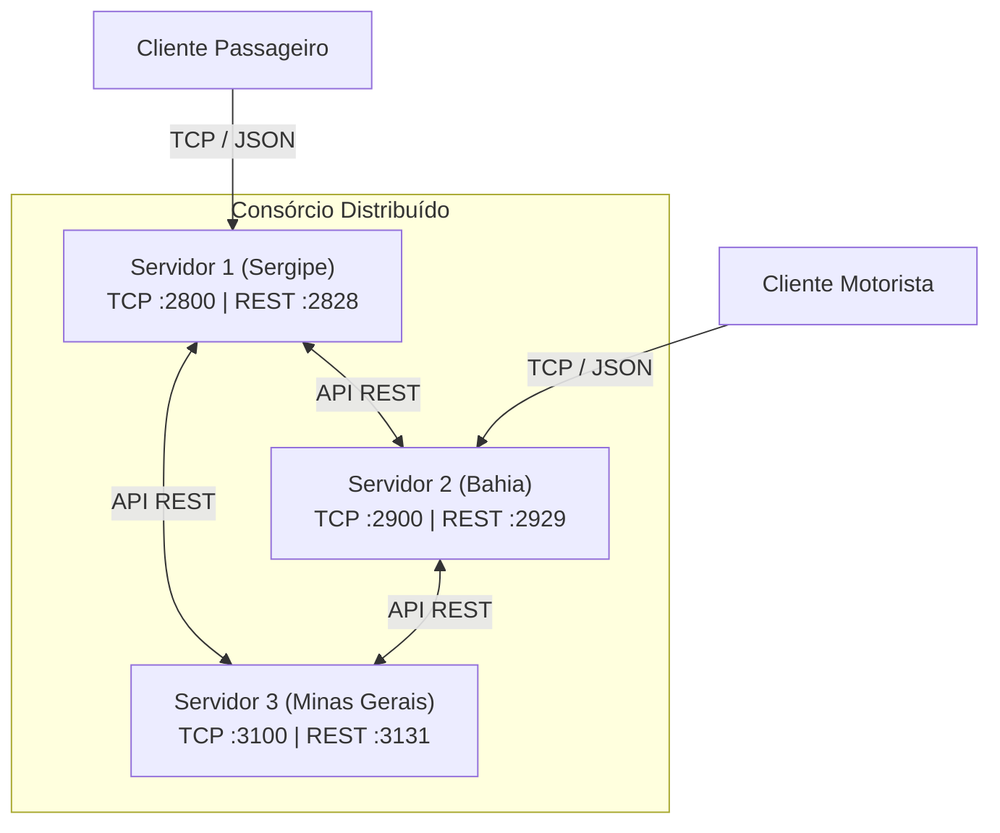
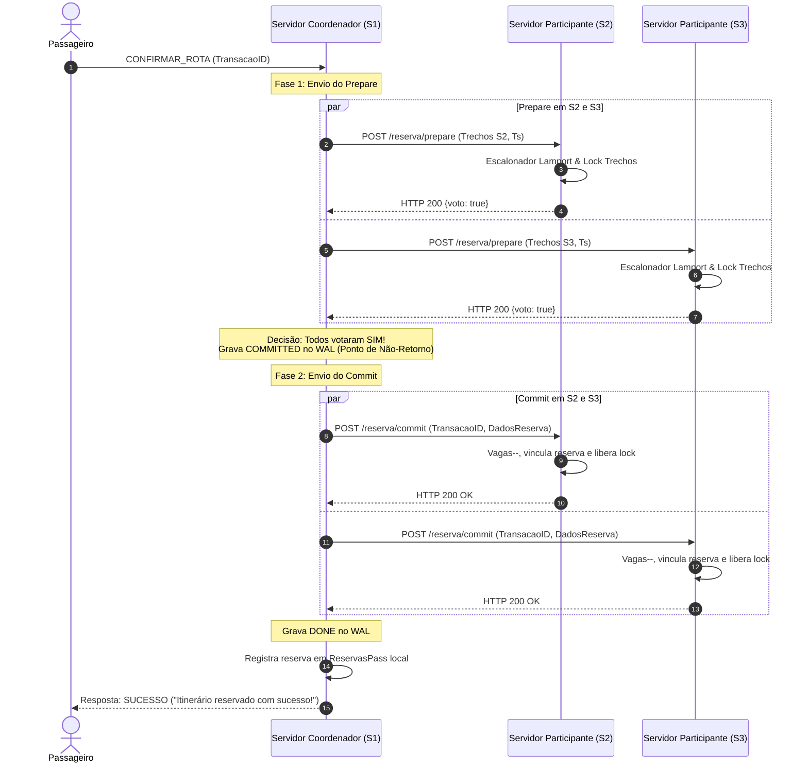

# VaiJunto — Consórcio de Caronas Compartilhadas (Problema 2)

Sistema distribuído de caronas compartilhadas de média e longa distância baseado em consórcio de empresas regionais, desenvolvido em **Go**. O sistema integra múltiplos servidores autônomos (Bahia, Minas Gerais e Sergipe) que colaboram para montar e reservar itinerários multi-trechos entre diferentes empresas, mantendo exclusão mútua, precedência justa, atomicidade (2PC) e tolerância a falhas com persistência em log (WAL).

Trabalho prático da disciplina **TEC502 — Concorrência e Conectividade**, Problema 2.

---

## Sumário

1. [Arquitetura](#1-arquitetura)
2. [Comunicação e Especificação da API REST](#2-comunicação-e-especificação-da-api-rest)
3. [Busca Distribuída de Itinerários](#3-busca-distribuída-de-itinerários)
4. [Exclusão Mútua](#4-exclusão-mútua)
5. [Atomicidade Distribuída (Protocolo 2PC)](#5-atomicidade-distribuída-protocolo-2pc)
6. [Precedência e Relógios Lógicos](#6-precedência-e-relógios-lógicos)
7. [Prevenção de Deadlock Distribuído](#7-prevenção-de-deadlock-distribuído)
8. [Tolerância a Falhas](#8-tolerância-a-falhas)
9. [Recuperação e Persistência (WAL e Banco)](#9-recuperação-e-persistência-wal-e-banco)
10. [Testes de Software](#10-testes-de-software)
11. [Emulação e Como Executar](#11-emulação-e-como-executar)
12. [Erros Encontrados e Lições Aprendidas](#12-erros-encontrados-e-lições-aprendidas)

---

## 1. Arquitetura

O consórcio é formado por **três servidores independentes**, cada um representando uma empresa regional de transporte:

| Servidor ID | Região / Estado | Porta TCP (Clientes) | Porta HTTP (REST Inter-Servidores) |
|---|---|---|---|
| **1** | Sergipe (SE) | `:2800` | `:2828` |
| **2** | Bahia (BA) | `:2900` | `:2929` |
| **3** | Minas Gerais (MG) | `:3100` | `:3131` |



### Papéis e Divisão de Responsabilidades
- **Cada Servidor:**
  - Mantém o cadastro dos seus próprios usuários (motoristas e passageiros locais) via `Motoristas` e `Passageiros` (`sync.Map`).
  - Mantém suas caronas publicadas em `ViagensMoto` e suas reservas locais em `ReservasPass`.
  - Armazena as arestas locais do grafo de rotas (`GrafoRotas.Adjacencias`).
  - Executa um coordenador de transações locais (`Transacoes`) e escalonador com fila de pedidos ordenada por relógio lógico.
  - Expõe uma porta TCP para clientes locais e uma porta HTTP REST para comunicação interna do consórcio.
- **Cliente Motorista (`cmd/motorista/`):** conecta via TCP ao servidor da sua empresa para cadastrar rotas, listar viagens e passageiros confirmados, ou cancelar viagens.
- **Cliente Passageiro (`cmd/passageiro/`):** conecta via TCP ao servidor da sua empresa para buscar rotas (locais ou compostas entre servidores), confirmar ou recusar opções de reserva, listar suas reservas e consultar notificações.

### Comparativo: Problema 1 (Centralizado) vs. Problema 2 (Distribuído)

| Aspecto | Problema 1 (Centralizado) | Problema 2 (Consórcio Distribuído) |
|---|---|---|
| **Topologia** | Servidor único com visão global de dados | Múltiplos servidores autônomos sem memória compartilhada |
| **Busca de Rotas** | DFS em grafo local único em memória | DFS distribuída consultando adjacências remotas via REST em tempo real |
| **Exclusão Mútua** | Mutexes em memória de processo único | Fila escalonada com Relógio Lógico de Lamport + Lock Leases |
| **Confirmação de Reserva** | Decremento direto de vagas em seção crítica local | Protocolo Two-Phase Commit (2PC) com coordenador e participantes |
| **Precedência de Pedidos** | Ordem de chegada no lock local | Ordem total definida pelo carimbo de Lamport `(Tempo, ServidorID)` |
| **Tolerância a Falhas** | Servidor caiu = sistema indisponível | Falhas parciais tratadas com timeouts, leases e recuperação via WAL |

---

## 2. Comunicação e Especificação da API REST

A comunicação entre os servidores do consórcio ocorre por HTTP/1.1 REST com payloads JSON e cabeçalho `X-Lamport-Clock` para sincronização de relógios lógicos em todas as mensagens.

### Endpoints da API REST

| Método | Endpoint | Papel no Protocolo | Payload (`PacoteHttp`) | Resposta |
|---|---|---|---|---|
| `GET` | `/adjacencias/{cidade}` | Busca distribuída | Vazio | `{trechos: []TrechoData}` |
| `POST` | `/reserva/prepare` | Fase 1 do 2PC (Reserva) | `{transacaoid, trechos, timestamp}` | `{voto: true/false}` (HTTP 200/409) |
| `POST` | `/reserva/commit` | Fase 2 do 2PC (Efetivação) | `{transacaoid, passageiro: ReservaChave}` | HTTP 200 |
| `POST` | `/reserva/abort` | Fase 2 do 2PC (Descarte) | `{transacaoid}` | HTTP 200 |
| `POST` | `/reserva/remover/prepare` | Fase 1 do 2PC (Cancelamento pelo passageiro) | `{transacaoid, trechos}` | `{voto: true/false}` |
| `POST` | `/reserva/remover/commit` | Fase 2 do 2PC (Efetivação de cancelamento) | `{transacaoid, reservas}` | HTTP 200 |
| `POST` | `/viagem/cancelar/prepare` | Fase 1 (Cancelamento pelo motorista) | `{transacaoid, reservas}` | `{voto: true, trechos: []TrechoData}` |
| `POST` | `/viagem/cancelar/commit` | Fase 2 (Cancelamento pelo motorista) | `{transacaoid, motorista}` | HTTP 200 |
| `POST` | `/viagem/cancelar/abort` | Abort de cancelamento de viagem | `{transacaoid}` | HTTP 200 |

### Comportamento em Falhas de Rede e Idempotência
- **Timeout HTTP do Cliente:** as requisições inter-servidores usam timeout configurado (`cliente = &http.Client{Timeout: 200ms}`).
- **Retry com Idempotência:**
  - O commit de reserva (`ReservaCommit`) realiza até 3 tentativas com intervalo de 500ms em caso de falhas transitórias.
  - No participante, `handlePostReservaCommit` possui mapa em memória (`commitadas.ids`) e registro em WAL (`COMMITTED`). Se uma requisição de commit for repetida por retry ou recovery, o participante retorna HTTP 200 imediatamente sem decrementar as vagas uma segunda vez.

---

## 3. Busca Distribuída de Itinerários

A busca por caronas é implementada em `grafo.go` via busca em profundidade (DFS) distribuída:

1. O passageiro solicita uma rota `Origem → Destino` na data desejada ao seu servidor local.
2. O servidor consulta os trechos locais que partem da cidade atual (`g.Adjacencias[atual]`).
3. Em seguida, consulta em tempo real os servidores vizinhos através de `GET /adjacencias/{cidade}` (`cfg.Vizinho(1)` e `cfg.Vizinho(2)`).
4. As arestas remotas são combinadas com as locais, permitindo encontrar itinerários compostos por trechos de empresas e estados distintos.
5. **Comportamento se um servidor vizinho estiver fora do ar:** a chamada HTTP retorna erro de conexão/timeout rapidamente e é logada. A busca continua normalmente explorando apenas os trechos dos servidores disponíveis, garantindo degradação graciosa.

---

## 4. Exclusão Mútua

Para evitar *overbooking* (duas pessoas reservando o último assento do mesmo trecho simultaneamente):

1. **Locks Granulares por Trecho:** cada trecho possui seu próprio mutex (`t.mu`).
2. **Escalonador Centralizado no Servidor Dono do Trecho:** quando um pedido de reserva chega a um participante via `/reserva/prepare`, ele é encapsulado em um `pedidoReserva` e inserido na fila do escalonador local (`escalonador.go`).
3. O escalonador analisa a fila respeitando a janela de ordenação e a precedência do relógio de Lamport.
4. Somente após vencer a disputa de precedência e verificar disponibilidade (`t.Vagas > 0`), o trecho é travado em `transacoes.TravarComTimeout`.

---

## 5. Atomicidade Distribuída (Protocolo 2PC)

A reserva de itinerários multi-trechos utiliza o protocolo de **Two-Phase Commit (2PC)**, onde o servidor onde o passageiro está conectado atua como **Coordenador**, e os servidores que possuem trechos da rota atuam como **Participantes**.

### Fases do Protocolo
- **Fase 1 (Prepare):**
  - O coordenador gera um `TransacaoID` (UUID) e carimba o pedido com seu relógio lógico.
  - Envia requisições concorrentes `POST /reserva/prepare` para todos os participantes envolvidos.
  - Cada participante avalia a disponibilidade e responde com voto `true` (locks concedidos) ou `false`.
- **Decisão do Coordenador:**
  - Se **todos** os participantes votarem `true`, o coordenador grava `COMMITTED` no log WAL (atingindo o ponto de não-retorno) e avança para o Commit.
  - Se **qualquer** participante votar `false` ou sofrer timeout, o coordenador envia `POST /reserva/abort` para todos que votaram sim, liberando as vagas.
- **Fase 2 (Commit):**
  - O coordenador envia `POST /reserva/commit` aos participantes.
  - Cada participante efetiva o consumo da vaga (`t.Vagas--`), vincula a reserva ao trecho e libera as travas.

### Diagrama de Sequência: Confirmação de Reserva Multi-Servidor (2PC)



### Cenário de Recusa (Abort)
Se o Servidor 3 responder `{voto: false}` no Prepare:
1. O Coordenador detecta a recusa na Fase 1.
2. Dispara `POST /reserva/abort` imediatamente para o Servidor 2.
3. O Servidor 2 descarta as travas reservadas e cancela o timer.
4. O Coordenador responde ao passageiro com a próxima opção de rota ou falha, sem deixar vagas presas.

---

## 6. Precedência e Relógios Lógicos

Como os servidores rodam em máquinas físicas distintas sem relógios perfeitamente sincronizados:

- **Relógio Lógico de Lamport (`cmd/servidor/relogioLogico/`):**
  - Cada mensagem HTTP carrega o cabeçalho `X-Lamport-Clock`.
  - Ao receber requisições, o servidor atualiza seu relógio: `L_local = max(L_local, L_msg) + 1`.
- **Desempate Determinístico:** os carimbos de transação são tuplas `Timestamp{Tempo: int64, ServidorID: int}`. Em caso de empate no valor de tempo lógico, o critério de menor `ServidorID` define a prioridade de forma consistente em todo o consórcio.
- **Janela de Ordenação:** o escalonador retém os pedidos recebidos durante uma janela de 50ms antes de conceder o prepare, permitindo que mensagens que sofreram pequenos atrasos na rede sejam reordenadas na fila pela ordem real de Lamport antes de uma decisão prematura.

---

## 7. Prevenção de Deadlock Distribuído

Deadlocks circulares (ex.: Transação A trava trecho em S1 e pede trecho em S2; Transação B trava trecho em S2 e pede trecho em S1) são prevenidos através de duas estratégias combinadas:

1. **Ordenação por Timestamp no Escalonador:** pedidos com carimbos de Lamport mais antigos têm prioridade estrita de acesso aos trechos.
2. **Lock Leases (Timeouts de Travas Órfãs):**
   - Toda trava adquirida no prepare recebe um timer automático associado (`TravarComTimeout`).
   - Transações de reserva possuem TTL de 16 segundos (`timeoutTransacaoReserva`).
   - Demais operações possuem TTL de 10 segundos (`timeoutTransacaoPadrao`).
   - Se o coordenador cair antes de enviar commit ou abort, o timer expira e executa `AbortarPorTimeout`, liberando os trechos automaticamente para outras reservas.

---

## 8. Tolerância a Falhas

O sistema trata falhas em diferentes estágios do ciclo de vida da transação:

- **Coordenador cai antes do passageiro confirmar:**
  - O participante nunca recebe commit; os timers de trava órfã disparam após 16s e liberam os trechos.
  - Ao reiniciar, o recovery do coordenador lê `PREPARED` sem `COMMITTED` no WAL e envia `ReservaAbort` por precaução.
- **Participante cai durante a Fase 1 (Prepare):**
  - O coordenador recebe timeout de conexão HTTP (200ms) e contabiliza o voto como `false`.
  - Envia abort aos demais participantes que votaram sim.
- **Participante cai durante a Fase 2 (Commit):**
  - O coordenador já gravou `COMMITTED` no WAL (ponto de não-retorno).
  - O coordenador tenta enviar com retry de 3 tentativas; se o participante continuar fora, entra em retry persistente em background.
  - Quando o participante reinicia, seu recovery lê o prepare do log (`wal_participante`) e, ao receber o commit reenviado, aplica o decremento da vaga com sucesso.
- **Coordenador cai durante a Fase 2 (Commit):**
  - Ao reiniciar, o `RecuperarWAL` detecta transações com `COMMITTED` sem `DONE`.
  - O coordenador reenvia os commits pendentes aos participantes e grava `DONE` após confirmação.

---

## 9. Recuperação e Persistência (WAL e Banco)

Para assegurar recuperação de estado consistente após falhas de hardware ou reinício dos processos, o sistema utiliza duas camadas de persistência:

### 1. Write-Ahead Log (WAL) em Disco (`cmd/servidor/wal.go`)
Arquivos append-only com uma entrada JSON por linha e chamada explícita de `Sync()` (`fsync`) após cada escrita:

- **WAL do Coordenador (`dados/wal_reservas_srvX.jsonl`):**
  - Registra transições de estado: `PREPARED` → `COMMITTED` → `ACK` (por servidor) → `DONE`.
  - Permite retomar commits interrompidos pelo reinício do coordenador.
- **WAL do Participante (`dados/wal_participante_srvX.jsonl`):**
  - Registra `PREPARED` com as chaves dos trechos travados.
  - Registra `COMMITTED` ou `ABORTED` ao término.
  - Se o participante cair e voltar, `RecuperarWALParticipante` restaura as chaves preparadas em `pendentesCommit`, viabilizando o commit tardio do coordenador.

### 2. Snapshot Periódico do Banco (`cmd/servidor/banco.go`)
- Goroutine executada a cada 10 segundos chamando `Salvar()`.
- Salva o estado dos usuários, caronas publicadas e reservas confirmadas em `dados/dados_servidor.json`.
- Na inicialização, `Carregar()` reconstrói as estruturas em memória e redefine `LoggedIn = false` para todos os usuários (evitando sessões órfãs).

---

## 10. Testes de Software

O sistema conta com suíte de testes de integração e validação ponta a ponta em `testes/e2e_test.go`:

```bash
# Executar a suíte de testes
go test -v ./testes
```

### Cenários Cobertos pelos Testes
1. **Reserva Multi-Trecho e Multi-Servidor:** validação do fluxo 2PC distribuído entre diferentes instâncias.
2. **Concorrência e Esgotamento de Vagas:** múltiplos passageiros disputando simultaneamente o mesmo assento; validação de que não ocorre overbooking.
3. **Precedência de Lamport:** injeção de requisições concorrentes com carimbos temporais distintos para validar concessão ao carimbo mais antigo.
4. **Cancelamento em Cascata:** motorista removendo carona com passageiros confirmados; verificação de notificação e liberação das vagas.
5. **Timeout de Travas Órfãs:** injeção de prepare sem envio de commit/abort, comprovando liberação automática das vagas após expiração do lease de 16 segundos.
6. **Injeção de Falha em Participante:** simulação de queda durante o ciclo de reserva e verificação de consistência e retry.

---

## 11. Emulação e Como Executar

### Pré-requisitos
- **Go 1.22+** instalado.
- Terminal compatível com comandos bash/powershell.

### Execução Local (Três Servidores na Mesma Máquina)

Cada servidor precisa ser iniciado em um terminal próprio com suas variáveis de ambiente:

```bash
# Terminal 1 — Servidor 1 (Sergipe)
servidor=1 endereco1=127.0.0.1 endereco2=127.0.0.1 endereco3=127.0.0.1 go run ./cmd/servidor

# Terminal 2 — Servidor 2 (Bahia)
servidor=2 endereco1=127.0.0.1 endereco2=127.0.0.1 endereco3=127.0.0.1 go run ./cmd/servidor

# Terminal 3 — Servidor 3 (Minas Gerais)
servidor=3 endereco1=127.0.0.1 endereco2=127.0.0.1 endereco3=127.0.0.1 go run ./cmd/servidor
```

### Execução dos Clientes

```bash
# Cliente Motorista conectado ao Servidor 2 (Bahia :2900)
endereco=127.0.0.1:2900 go run ./cmd/motorista

# Cliente Passageiro conectado ao Servidor 1 (Sergipe :2800)
endereco=127.0.0.1:2800 go run ./cmd/passageiro
```

### Execução em Máquinas Distintas do Laboratório (LARSID/LADICA)

Para rodar em computadores separados na rede do laboratório:

1. Identifique o IP de cada computador na rede local (ex.: Máquina A = `192.168.1.10`, Máquina B = `192.168.1.11`, Máquina C = `192.168.1.12`).
2. Inicie o servidor em cada máquina apontando os 3 endereços correspondentes:
   ```bash
   # Na Máquina 1 (Sergipe):
   servidor=1 endereco1=192.168.1.10 endereco2=192.168.1.11 endereco3=192.168.1.12 go run ./cmd/servidor

   # Na Máquina 2 (Bahia):
   servidor=2 endereco1=192.168.1.10 endereco2=192.168.1.11 endereco3=192.168.1.12 go run ./cmd/servidor

   # Na Máquina 3 (Minas Gerais):
   servidor=3 endereco1=192.168.1.10 endereco2=192.168.1.11 endereco3=192.168.1.12 go run ./cmd/servidor
   ```
3. Conecte os clientes apontando a variável `endereco` para o IP e porta TCP do servidor desejado:
   ```bash
   endereco=192.168.1.11:2900 go run ./cmd/motorista
   endereco=192.168.1.10:2800 go run ./cmd/passageiro
   ```

### Demonstração de Falha em Apresentação
Para demonstrar a tolerância a falhas exigida pelo barema:
1. Inicie uma reserva composta que utilize trechos de dois servidores (ex.: S1 e S2).
2. Interrompa o processo do Servidor 2 via `Ctrl+C` ou encerrando o terminal antes da confirmação final do passageiro.
3. Observe no log do Servidor 1 a detecção de indisponibilidade e o descarte correto da reserva sem travar o sistema.
4. Reinicie o Servidor 2 e observe o recovery do WAL reconstruindo o estado limpo e liberando vagas órfãs.

---

## 12. Erros Encontrados e Lições Aprendidas

Durante o desenvolvimento, depuração e validação do consórcio distribuído, foram enfrentados e analisados cenários críticos de projeto:

### 1. O Dilema do Timeout de Travas no Participante (Lock Leases vs. Consistência 2PC)
- **O problema:** Para evitar que a queda de um coordenador bloqueasse trechos indefinidamente (travas órfãs), implementou-se um timer de timeout nas travas do lado dos participantes após o voto de prepare. No entanto, esse timeout unilateral no participante **não é ideal e pode introduzir inconsistências graves**: se a rede sofrer atrasos ou o passageiro demorar para confirmar próximo ao limite do lease, o participante pode considerar a transação expirada e liberar o assento para outra reserva concorrente. Se logo em seguida o coordenador decidir `COMMIT` e enviar a mensagem, ocorre uma colisão: o participante ou rejeita o commit tardio (gerando falha parcial e quebra da reserva multi-servidor) ou o aceita em cima de um trecho já doado para outro cliente, causando *overbooking*.
- **A abordagem ideal:** No 2PC estrito, após votar `PREPARED`, o participante cede sua autonomia decisória. A arquitetura mais segura é **concentrar o timeout de decisão exclusivamente no Coordenador**. Caso o passageiro ou a rede demorem além do limite tolerável, é o coordenador quem toma a decisão oficial de `ABORT` e envia comandos de abort (com retry persistente) a todos os participantes. O participante só deveria descartar travas por conta própria em último caso mediante protocolo de cooperação entre participantes ou probes de vivacidade do coordenador.

### 2. Backtracking na DFS Corrompendo Slices Compartilhados
- **O problema:** A DFS recursiva do grafo (`dfsBusca` em `grafo.go`) utilizava um único slice de booleanos para rastrear quais servidores participavam da rota que estava sendo explorada. No caso base (destino alcançado), o slice era anexado ao resultado por referência, sem cópia profunda. Quando a recursão desempilhava (backtracking), os flags eram revertidos para `false`, corrompendo o itinerário já armazenado e fazendo com que o coordenador achasse que nenhum servidor participava da rota (`servidores = [false, false, false]`), pulando silenciosamente a emissão do commit via rede.
- **A correção:** O caso base passou a realizar cópia profunda (`copy`) do slice de servidores, e foi criada a função `ObterServidoresParticipantes()`, que deduz os participantes inspecionando diretamente os IDs dos servidores em cada `TrechoData` da rota, tornando a operação imune a inconsistências na travessia do grafo.

### 3. Ponto de Não-Retorno e a Impossibilidade de "Abort Compensatório"
- **O problema:** Ao lidar com a falha de entrega de um commit a um participante secundário, cogitou-se enviar um "abort especial" para desfazer o commit nos participantes que já haviam confirmado com sucesso.
- **A lição do 2PC:** No 2PC clássico, após cruzar a decisão de commit (Fase 2), o coordenador atinge o **ponto de não-retorno**. Desfazer um commit localmente aplicado viola o princípio da atomicidade: as travas do trecho já foram liberadas no participante que comitou, e uma terceira transação pode ter consumido a vaga liberada milissegundos depois. Portanto, a resposta correta para falhas na Fase 2 é o **retry persistente** apoiado por WAL e idempotência, garantindo que o participante atrasado eventualmente aplique o commit quando restabelecido.
